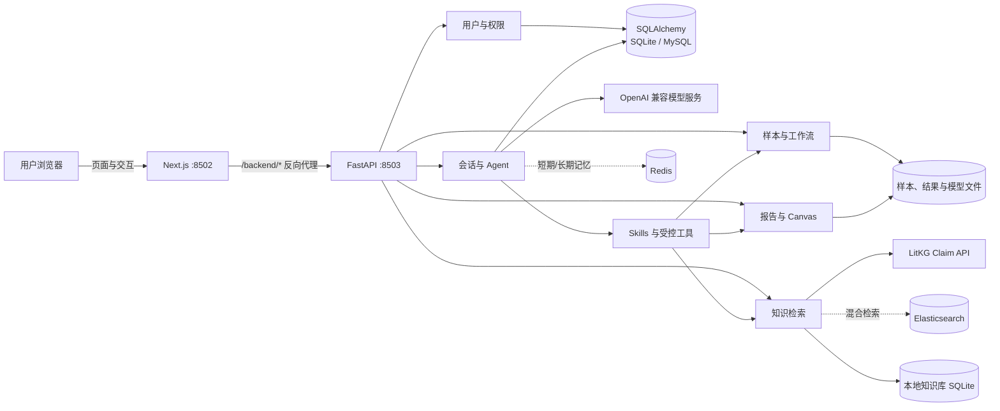

# WGS-FMT-Agent v2 项目架构与使用指南

本文面向第一次接触项目的开发者、部署人员和科研用户，用于快速理解系统组成、常用依赖、
数据流向和日常使用方式。

## 1. 一句话说明

WGS-FMT-Agent v2 是一个肠道菌群与 FMT 科研分析平台：浏览器使用 Next.js 页面，FastAPI
提供业务接口，Agent 调用样本分析、知识检索、供受体匹配、报告生成和 Canvas 工具，用户、
会话及消息通过 SQLAlchemy 持久化。

## 2. 五分钟理解整体架构



需要记住的边界：

- Next.js 负责页面、状态和交互，不直接查询数据库；
- FastAPI 负责校验请求、组织业务、调用数据库和工具，向前端返回 JSON 或文件；
- SQL 保存结构化业务数据，样本和大型分析产物保存在文件系统；
- Redis、Elasticsearch 和 LitKG 是可插拔的外部能力，不是页面服务器。

## 3. 目录结构

```text
WGS-FMT-Agent-v2/
├── apps/
│   ├── workspace-web/          # Next.js 前端，端口 8502
│   └── workspace-api/          # FastAPI 工作区接口，端口 8503
├── src/
│   ├── wgs_agent/              # Agent 循环、Skills、工具、分析与报告逻辑
│   └── wgs_fmt_platform/       # 数据库、记忆、检索、模型、工作流等平台能力
├── knowledge_base/             # 本地知识库脚本、Schema 和查询接口
├── infrastructure/             # MySQL/PostgreSQL/SQLite 初始化脚本
├── scripts/                    # FMT 训练、预测、绘图和回填脚本
├── tests/                      # 后端、模型、知识库、工作流测试
├── deploy/                     # 启动、停止、状态和隧道脚本
├── docs/                       # 架构、环境和部署文档
├── requirements.txt            # 全部 Python 包的精确版本
├── pyproject.toml              # Python 项目及依赖组声明
├── uv.lock                     # Python 完整锁文件
├── environment.yml             # Python/Node/Pandoc 环境入口
└── .env.production.example     # 生产配置模板，不含真实密钥
```

运行时数据默认放在源码目录之外：

```text
/storage/main/users/zhangrongpeng/data/fmt/wgs-fmt-agent-v2-data/
├── logs/                       # 服务日志
├── run/                        # PID 文件
├── results/                    # 分析与报告结果
├── sandboxes/                  # 每个用户/会话的 Canvas 沙盒
├── uploads/                    # 上传的测序文件
├── upload-jobs/                # 上传处理任务
├── traces/                     # Agent 执行轨迹
├── artifacts/                  # 通用产物
└── model-registry/             # 模型版本与部署信息
```

## 4. 核心服务和端口

| 服务 | 技术 | 端口 | 职责 |
|---|---|---:|---|
| `workspace-web` | Next.js | 8502 | 登录、对话、样本、知识库、报告、设置页面 |
| `workspace-api` | FastAPI | 8503 | REST API、数据库、Agent、文件和工作流接口 |
| `agent-daemon` | Python Agent | 7438 | 可选后台 Agent 服务，配置模型密钥后启动 |
| MySQL | SQL数据库 | 3306 | 正式环境的用户、会话和业务数据 |
| Redis | 内存数据库 | 6379 | 短期/长期记忆缓存 |
| Elasticsearch | 检索服务 | 9200 | 关键词、向量及融合检索 |
| LitKG | 外部 Claim API | 由服务端配置 | 文献 Claim、实体关系与知识图谱 |

浏览器一般只访问 `8502`。Next.js 将 `/backend/*` 转发到本机 `8503`，不需要把 FastAPI
端口直接暴露给普通用户。

## 5. 常用依赖包

精确的完整版本以根目录 `requirements.txt` 和前端 `package-lock.json` 为准。下面列出开发和
排障时最常接触的包。

### 5.1 后端与接口

| 包 | 当前锁定版本 | 用途 |
|---|---:|---|
| FastAPI | 0.139.0 | REST API、参数校验和接口文档 |
| Uvicorn | 0.51.0 | 运行 FastAPI 的 ASGI 服务 |
| Pydantic | 2.13.4 | 请求、响应及配置模型校验 |
| pydantic-settings | 2.14.2 | 从 `.env` 和环境变量读取设置 |
| python-multipart | 0.0.32 | FASTQ 等文件上传 |
| HTTPX | 0.28.1 | 调用 LitKG 和其他 HTTP 服务 |
| Jinja2 | 3.1.6 | 报告模板渲染 |
| Typer | 0.26.8 | 命令行工具 |

### 5.2 数据库、缓存与检索

| 包 | 当前锁定版本 | 用途 |
|---|---:|---|
| SQLAlchemy | 2.1.5 | ORM、数据库连接和事务 |
| PyMySQL | 1.2.3 | MySQL 驱动 |
| psycopg | 3.3.4 | PostgreSQL 可选驱动 |
| Redis | 8.1.0 | Agent 记忆缓存 |
| Elasticsearch | 8.19.3 | 关键词、向量和融合检索 |
| boto3 | 1.43.47 | S3/对象存储扩展能力 |

### 5.3 模型、Agent与知识调用

| 包 | 当前锁定版本 | 用途 |
|---|---:|---|
| OpenAI SDK | 3.35.1 | OpenAI 兼容模型服务调用 |
| Anthropic SDK | 1.15.0 | Anthropic 模型可选支持 |
| python-dotenv | 1.2.2 | 加载项目 `.env` |
| Textual | 8.2.8 | 可选终端界面 |
| Rich | 15.0.0 | 命令行富文本输出 |

### 5.4 科研分析与模型训练

| 包 | 当前锁定版本 | 用途 |
|---|---:|---|
| NumPy | 2.5.4 | 数组和数值计算 |
| pandas | 3.0.6 | 样本、物种和评测表格处理 |
| SciPy | 1.18.1 | 统计检验和科学计算 |
| scikit-learn | 1.9.1 | 降维、分类、评测和基线模型 |
| PyTorch | 2.14.1 | FMT Triplet/深度模型训练与推理 |
| Matplotlib | 3.11.2 | 论文级静态图 |
| Seaborn | 0.13.2 | 统计可视化 |
| Plotly | 7.1.0 | 交互式图表 |
| OpenPyXL | 3.1.5 | Excel 数据读取与导出 |
| fpdf2 | 2.8.9 | Unicode PDF 降级生成 |

### 5.5 前端

| 包 | 当前声明版本 | 用途 |
|---|---:|---|
| Next.js | 15.5.27 | 页面、路由、服务端运行和后端代理 |
| React / React DOM | 19.1.1 | 页面组件和状态管理 |
| TypeScript | 5.7.2 | 静态类型检查 |
| react-markdown | 10.1.0 | 将 Agent Markdown 回答渲染为页面 |
| remark-gfm | 4.0.1 | 表格、任务列表等 GFM 扩展 |
| Lucide React | 0.468.0 | 页面图标 |
| Tailwind CSS | 3.4.17 | 样式构建依赖 |

### 5.6 外部程序

这些不是普通 Python 包，需要在服务器独立安装或提供服务：

- Python 3.12；
- Node.js 22 LTS（当前服务器可运行版本为 Node 26）；
- MySQL 8、Redis 7、Elasticsearch 8；
- mProject 宏基因组分析命令；
- Nextflow 工作流引擎；
- Pandoc 和 XeLaTeX，用于高质量 PDF，可选；
- Docker，用于启用 Docker Workspace 沙盒时使用。

## 6. 页面与后端模块对应关系

| 用户看到的模块 | 前端目录 | FastAPI接口 | 主要数据来源 |
|---|---|---|---|
| 登录与注册 | `components/auth-access.tsx` | `/api/backend/auth/*` | SQL用户和Session表 |
| 智能体对话 | `app/chat/page.tsx` | `/api/chat` | SQL会话、模型服务、Agent工具 |
| 会话记忆 | 对话页“会话记忆”标签 | `/api/backend/conversations*` | SQL会话和消息表 |
| 执行轨迹 | 对话页“执行轨迹”标签 | `/api/chat`响应中的`trace` | 消息JSON字段、审计记录 |
| Canvas | 对话页“Canvas”标签 | `/api/canvas/*` | 当前会话沙盒文件 |
| 样本与分析 | `app/samples/page.tsx` | `/api/samples*` | 上传目录、Pipeline和结果文件 |
| 知识库 | `app/knowledge/page.tsx` | `/api/knowledge/*` | 本地知识库、LitKG、ES |
| 报告中心 | `app/reports/page.tsx` | `/api/reports/*` | Markdown、PDF、JSON及图片 |
| Agent与Skills | `app/settings/page.tsx` | `/api/agents`、`/api/skills`、`/api/settings` | JSON配置文件 |

## 7. 三条最重要的调用链

### 7.1 登录

```text
登录弹窗
 → api.login()
 → Next.js /backend 代理
 → FastAPI /api/backend/auth/login
 → SQLAlchemy 查询 users
 → 校验密码
 → auth_sessions 写入令牌摘要
 → 返回用户和令牌
 → 浏览器 localStorage 保存令牌
```

后续请求通过 `Authorization: Bearer <token>` 携带登录身份。数据库只保存令牌哈希，不保存
原始令牌。

### 7.2 Agent对话

```text
用户输入问题
 → 前端先显示用户消息
 → POST /api/chat
 → 读取 Agent、Skills 和系统设置
 → 从 SQL 读取最近 30 条消息
 → 保存本次用户消息
 → 调用模型生成计划
 → 在允许列表内选择并执行工具
 → 观察结果，必要时重规划
 → 生成最终 Markdown 回答
 → 保存回答、轨迹、Canvas和待确认动作
 → 前端用 ReactMarkdown 展示
```

写操作不会由模型直接执行。危险操作先生成 `pending_action`，用户点击确认后才调用
`/api/actions/confirm`。

### 7.3 样本分析和报告

```text
上传 FASTQ
 → /api/samples/upload
 → 写入 uploads
 → 启动受控样本处理脚本
 → 生成分析 JSON、图和状态
 → /api/samples/{id} 读取结果
 → /api/reports/{id}/generate 生成 Markdown/PDF
 → 报告中心或 Canvas 预览
```

大型 FASTQ、模型和报告不写入 SQL；SQL只适合保存索引、用户关系、状态和元数据。

## 8. 数据到底保存在哪里

| 数据类型 | 当前实现 | 推荐正式实现 |
|---|---|---|
| 用户、角色、登录Session | SQLAlchemy，当前运行中是 SQLite | MySQL |
| 会话、消息、消息轨迹 | SQLAlchemy，当前运行中是 SQLite | MySQL |
| 长短期记忆 | Redis接口已存在，当前服务未启动 | Redis + 重要摘要回写MySQL |
| Agent、Skills、模型设置 | JSON文件 | 可继续使用；多实例部署时迁入MySQL |
| FASTQ、分析JSON、图片、PDF | 文件系统 | 文件系统或对象存储，MySQL保存索引 |
| 本地文献与切片 | SQLite/文档目录 | MySQL元数据 + Elasticsearch索引 |
| LitKG Claim和关系 | 远程HTTP API | 继续远程调用并缓存必要结果 |
| 关键词和向量索引 | Elasticsearch接口已存在，当前服务未启动 | Elasticsearch 8 |
| Canvas文件 | 用户/会话隔离的沙盒目录 | 保持沙盒隔离并定期清理 |

截至 2026-10-18，运行中的后端健康检查显示：SQLite正常，Redis未启动，Elasticsearch未启动。
因此“支持 MySQL/Redis/ES”和“已经实际启用”需要区分。

## 9. 安装与启动

### 9.1 Python依赖

```bash
cd /storage/main/users/zhangrongpeng/data/fmt/apps/WGS-FMT-Agent-v2

python3.12 -m venv .venv
source .venv/bin/activate
python -m pip install --upgrade pip
python -m pip install -r requirements.txt
```

`requirements.txt` 是无注释的精确版本文件，可直接执行。若需要使用现有服务器环境，则使用：

```bash
source /storage/main/users/zhangrongpeng/data/fmt/runtime/envs/wgs-fmt-agent-v2/bin/activate
```

### 9.2 前端依赖

```bash
npm ci --prefix apps/workspace-web
npm run build --prefix apps/workspace-web
```

### 9.3 配置

```bash
cp .env.production.example .env
chmod 600 .env
```

必须替换模板中的 `CHANGE_ME`，不要把真实 `.env`、API Key或数据库密码提交到Git。

### 9.4 启动、状态、停止

```bash
bash deploy/start.sh
bash deploy/status.sh
bash deploy/stop.sh
```

访问地址：`http://10.181.9.172:8502/`。

### 9.5 健康检查

```bash
curl -fsS http://127.0.0.1:8503/health
curl -fsS http://127.0.0.1:8503/api/backend/health
curl -I http://127.0.0.1:8502/
```

第二个接口会分别显示 SQL、Redis 和 Elasticsearch 的连接状态。

## 10. 开发者常用入口

| 想修改的能力 | 首先查看 |
|---|---|
| 页面导航和用户入口 | `apps/workspace-web/components/app-shell.tsx` |
| 前端请求封装 | `apps/workspace-web/lib/api.ts` |
| 对话、轨迹和Canvas页面 | `apps/workspace-web/app/chat/page.tsx` |
| FastAPI工作区接口 | `apps/workspace-api/app/main.py` |
| Agent循环和工具执行 | `apps/workspace-api/app/agent_chat.py` |
| 用户、会话和消息表 | `src/wgs_fmt_platform/infrastructure/database.py` |
| 登录、记忆和检索接口 | `src/wgs_fmt_platform/infrastructure/api.py` |
| Redis记忆 | `src/wgs_fmt_platform/infrastructure/memory.py` |
| Elasticsearch检索 | `src/wgs_fmt_platform/infrastructure/search.py` |
| LitKG接入 | `src/wgs_fmt_platform/knowledge/` |
| 样本上传工作流 | `src/wgs_agent/pipeline/upload_workflow.py` |
| FMT训练与推理 | `scripts/train_fmt_triplet_model.py`、`scripts/predict_fmt_triplet_model.py` |
| 报告生成 | `src/wgs_agent/tools/report_maker.py` |

## 11. 当前需要注意的架构缺口

1. 运行环境仍使用 SQLite，生产 MySQL 尚未接管；
2. Redis 和 Elasticsearch 接口已经实现，但对应服务当前未运行；
3. 部分会话与对话接口仍使用内部 `local-researcher`，尚未全部绑定当前登录用户；
4. 会话读取需要补充严格的用户归属校验，才能达到真正的多用户数据隔离；
5. Agent设置和Skills保存在JSON文件，多实例部署时会出现配置同步问题；
6. `/api/chat` 当前是一次请求返回完整结果，长任务更适合改成SSE或WebSocket流式输出；
7. CORS当前允许所有来源，正式上线应限制为实际前端域名。

对于本地科研演示，这套结构可以运行；面向多人正式使用时，应优先完成用户隔离、MySQL迁移、
Redis记忆接入和服务权限收紧。

## 12. 新成员推荐阅读顺序

1. 本文：理解整体结构；
2. `README.md`：掌握最短启动方式；
3. `docs/ENVIRONMENT.md`：创建依赖和生产配置；
4. `apps/workspace-web/lib/api.ts`：理解前端如何请求后端；
5. `apps/workspace-api/app/main.py`：理解业务接口；
6. `infrastructure/database.py` 和 `infrastructure/api.py`：理解用户、会话和存储；
7. `agent_chat.py`：理解Agent计划、工具、观察、重规划和审计流程。
